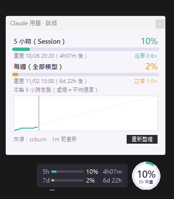

# Claude 用量小浮窗

待在螢幕角落的 Claude Code 用量監控小工具，不用再特地打開終端機查用量。
做法參考 [ccburn](https://github.com/JuanjoFuchs/ccburn)，浮窗操作沿用 `tomato_timer`。



## 功能

- **圓環**：直接顯示 5 小時 Session 用量百分比，顏色代表用量速度（綠＝從容、橘＝正常、紅＝偏快）。
- **小條**：5h / 7d 兩條用量與距離重置的倒數。
- **單擊展開詳細資訊**：5 小時、每週（全部模型）、Sonnet、Opus、月度額度（有資料才顯示）、
  重置時間、用量速度與預估用完時間、本輪 5 小時走勢圖。
- 可拖曳、位置會記住；右鍵選單可重新整理、移到四個角落、結束。

## 需求

- Windows、Python 3.10+（只用標準庫，不需另外安裝套件）
- 已登入 Claude Code（`~/.claude/.credentials.json` 存在）

## 使用

雙擊 `usage.pyw`，或：

```powershell
pythonw usage.pyw
```

| 操作 | 作用 |
| --- | --- |
| 單擊 | 打開 / 關閉詳細資訊（Esc 也可關閉） |
| 拖曳 | 移動位置 |
| 右鍵 | 選單 |

## 資料來源

1. **`~/.ccburn/history.db`** 最新一筆（ccburn 執行中，或 statusline 掛了 `ccburn collect` 時會持續更新），每 5 秒讀取。
2. 資料超過 5 分鐘沒更新時，改呼叫 OAuth usage API（`api.anthropic.com/api/oauth/usage`，讀取
   `~/.claude/.credentials.json` 的 access token）。最短間隔 3 分鐘；遇到 429 或錯誤會等 10 分鐘再試。

token 只用來呼叫上述 API，不會寫入任何檔案。設定（位置）存在 `%APPDATA%\ClaudeUsageWidget\data.json`。

可用 `CLAUDE_CONFIG_DIR` 指定其他 Claude 設定資料夾。
